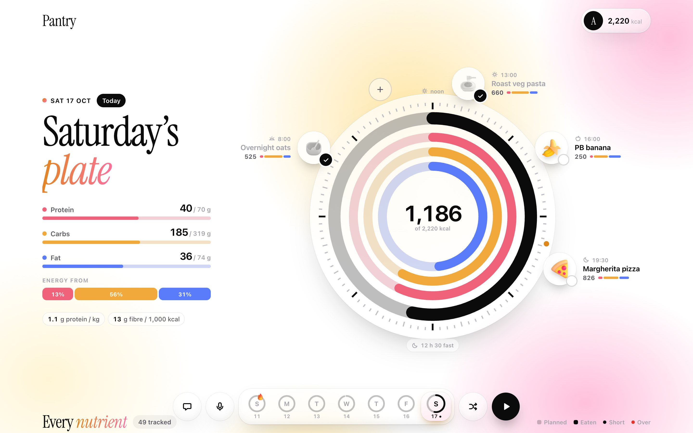
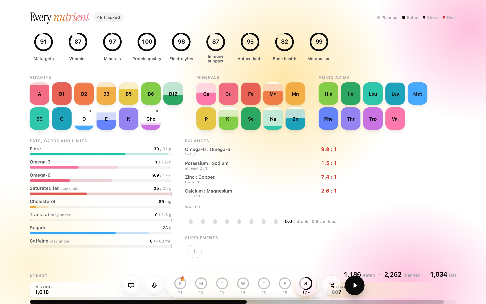
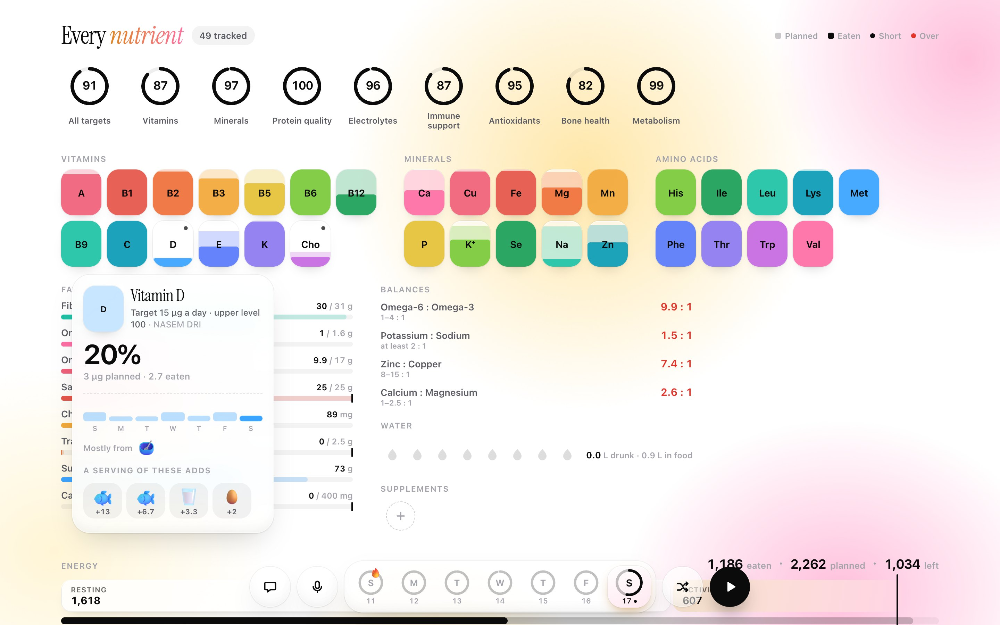
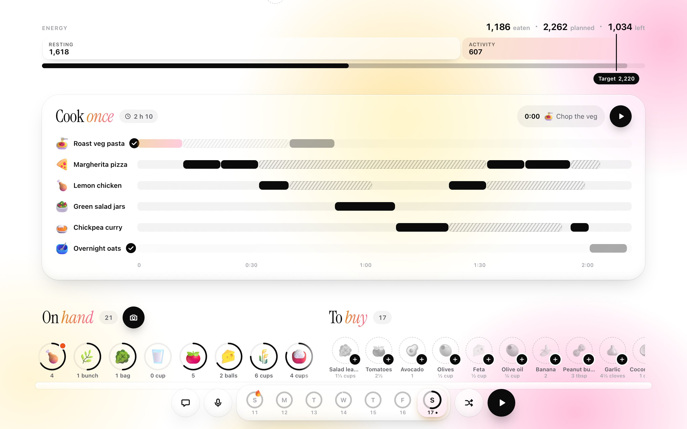
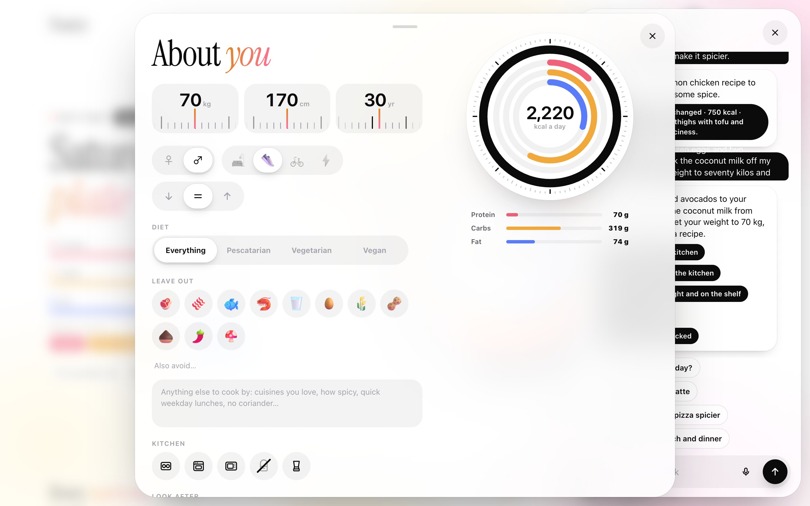
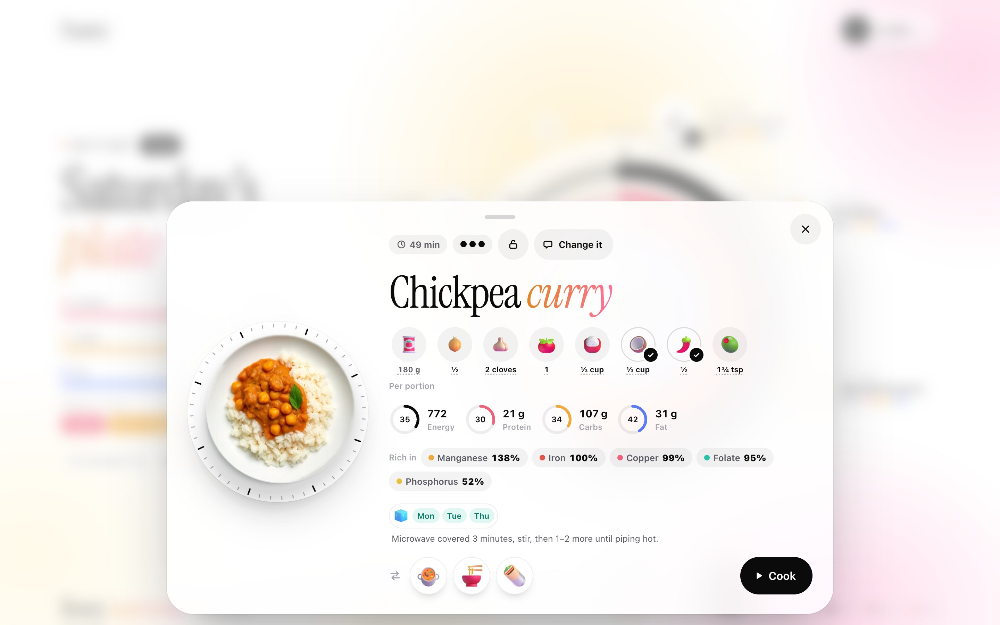
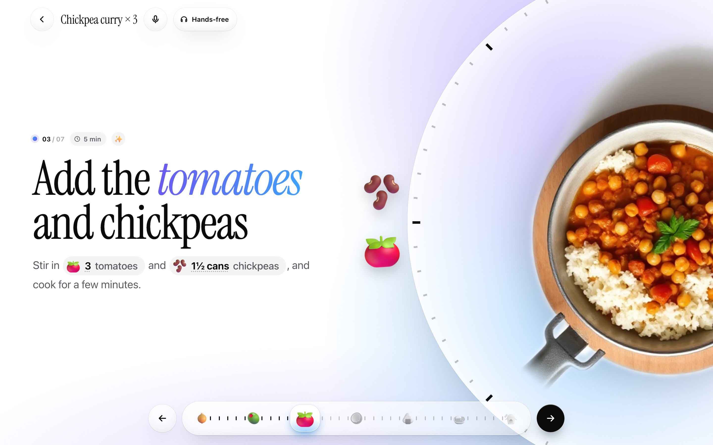
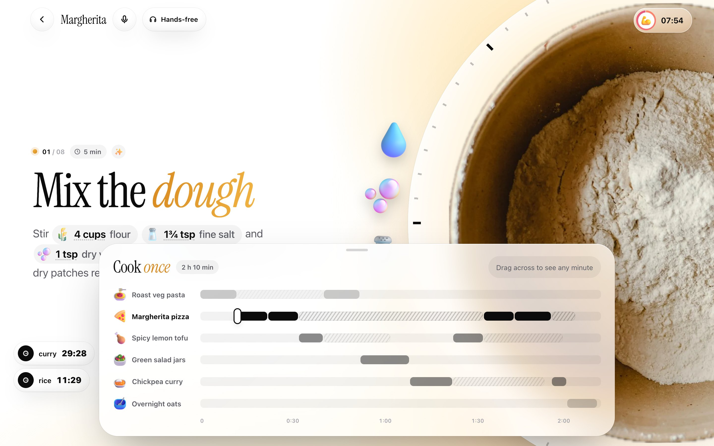
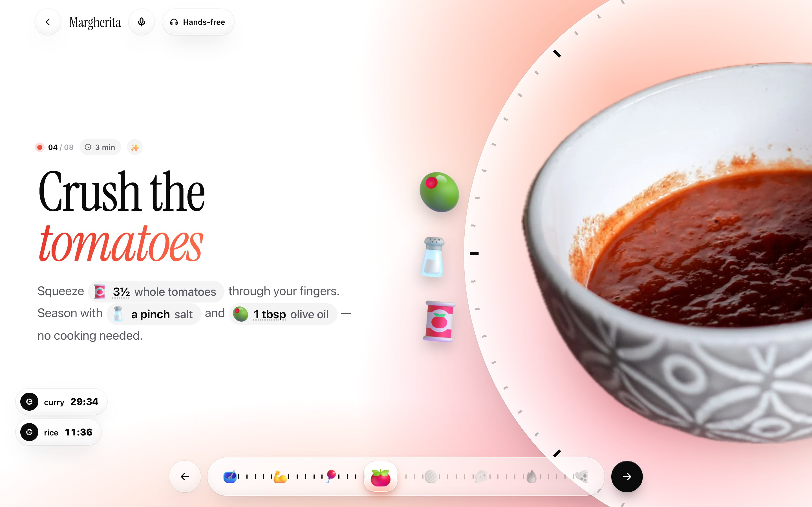
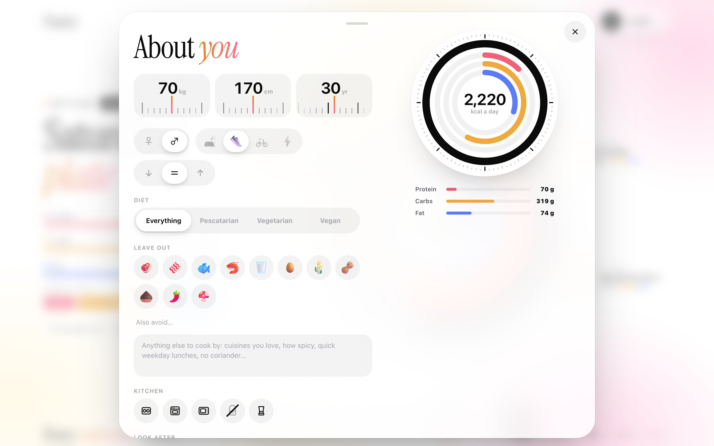

<div align="center">

# Pantry

**A week of food, planned around your body, cooked in one afternoon, tracked to the last microgram.**

Pantry works out what you need from who you are, plans a week of meals from what is in your kitchen,
lays the whole cook out on one timeline, and then follows 49 nutrients as you eat through it.
Every number on screen is computed from USDA data and the weight of each ingredient. The language model
chooses dishes and writes recipes; it never supplies a nutrient figure.




**[Try it live](https://abhinav-prabhakar.github.io/Pantry/)** · [how it is built](PLAN.md) · [design notes](DESIGN.md)

</div>

---

## Why this exists

Meal prep is three hard problems wearing one apron. What should I eat this week so the numbers add up, not only
calories and protein but iron, vitamin D, the omega balance? What can I make from what I already have? And how do
I cook six dishes on a Sunday afternoon without needing four hands at 3:40 pm?

Trackers answer the first after the fact. Recipe apps answer the second one dish at a time. Nothing answers the
third. Pantry treats them as one loop: targets shape the plan, the plan is scheduled as a single session, and what
you eat fills the same rings the plan was drawn on.

It is built for an iPad on a kitchen counter: big touch targets, things you drag instead of forms you fill, and a
microphone for when your hands are covered in dough.

## Screens

| | |
|---|---|
|  |  |
| **Every nutrient.** Nine scores, a tile for each vitamin, mineral and essential amino acid that fills like liquid as you eat, bars for fats and limits, four balances, water, and where the energy target comes from. | **One nutrient, up close.** Target and upper level, the week against the target line, which dishes it comes from, and foods that would close the gap. Tap one and it is on the shopping list. |
|  |  |
| **Cook once.** One lane per dish, solid where it needs hands and hatched where it does not, arranged so you are never needed in two places at once. Under it, the shelf: what you have, and what you need as grey gaps. | **Chat that draws.** Ask what you are short on and the answer comes with bars from your own numbers. Say "swap the chicken for tofu and make it spicier" and the recipe, its nutrients and the shopping list change. |
|  |  |
| **A dish.** What is in stock and what is missing, its share of the day, what it is rich in, alternatives to swap to, a lock that keeps it when the week is reshuffled, and "Change it" to rewrite it in chat. | **Cook mode.** Steps written by the model for the whole batch, one at a time on a turntable, with timers that follow you between steps. Say "next", "start the timer" or "add five minutes". |

<div align="center"></div>

<div align="center"> </div>

## How it fits together

```
  ┌───────────────────────────────────────────────────────────────┐
  │  the page    day clock · nutrient panel · cook-once ribbon    │  vanilla JS, one glass recipe,
  │              shelf · chat · voice · cook mode                 │  state in localStorage
  └───────────────────────────────▲───────────────────────────────┘
  ┌───────────────────────────────┴───────────────────────────────┐
  │  guard rail  every model answer is checked before use         │  unknown actions dropped, numbers clamped,
  │              and asked for again if it is unusable            │  markup stripped, gaps in a week filled
  └───────────────────────────────▲───────────────────────────────┘
  ┌───────────────────────────────┴───────────────────────────────┐
  │  language model   plan a week · write steps · change a dish   │  any OpenAI-compatible service;
  │                   read a shelf · answer and act in chat       │  chooses food, never numbers
  └───────────────────────────────▲───────────────────────────────┘
  ┌───────────────────────────────┴───────────────────────────────┐
  │  scheduler   several dishes, one cook: hands-off time in one  │  lib/schedule.js
  │              dish is used for hands-on work in another        │
  └───────────────────────────────▲───────────────────────────────┘
  ┌───────────────────────────────┴───────────────────────────────┐
  │  nutrition   targets from the profile · low / ok / over       │  lib/nutrition.js
  │              nine scores · four balances · energy sum         │
  └───────────────────────────────▲───────────────────────────────┘
  ┌───────────────────────────────┴───────────────────────────────┐
  │  food table  2,129 USDA foods × 49 nutrients per 100 g,       │  lib/foods.js, data/foods.json
  │              name matching, "what adds this nutrient?"        │
  └───────────────────────────────────────────────────────────────┘
```

**Principles**

- **The model picks, the table counts.** A recipe arrives as ingredients and grams. Its nutrients are summed from
  the food table, and its portions are scaled until the dish carries its share of your day's energy.
- **Show it, do not write it.** Amounts are rings, fills, rulers and the food itself. Text names things.
- **Pale is planned, solid is eaten.** One rule, on every ring, bar and tile in the app.
- **Nothing to install.** No framework, no bundler, no packages. One Node file serves it; without Node it still
  runs as static files.
- **One motion vocabulary.** Two springs and a fade. Things travel to where they are going instead of appearing.

## Highlights

- **Nutrition maxxing.** A plan is not done when the calories add up. Every day is scored against every target
  (vitamins, minerals, amino acids, fibre, omega-3), then the amounts are tuned and small, dense additions made
  where they suit the dish and the diet (chia in the oats, spinach in the curry). If targets are still short, the
  model sees the computed gaps and revises the week. What food rarely covers (B12 on a vegan diet, vitamin D)
  comes with supplement advice you can add in one tap. **Maxx it** re-tunes the week at any time.
- **Targets from the research**, by age, sex, pregnancy and breastfeeding: NASEM Dietary Reference Intakes,
  Mifflin-St Jeor energy, protein by activity and goal (ISSN, PROT-AGE), WHO amino acids. Each nutrient names
  its source; `lib/nutrition.js` cites them all.
- **Your diet, everywhere.** Vegetarian, vegan, pescatarian, allergens, pork, alcohol, dislikes. Plans and recipes
  are checked and the model corrected; the shelf, the shopping list, suggestions and swaps strike out what does
  not fit; the model judges sauces and ready foods the rules cannot.
- **Only what you have, or kitchen first.** A kitchen-only week fills as far as the food goes and says plainly
  when there are not enough ingredients, with what is missing.
- **Supplements** from a label line, a brand or by voice, counted toward the day once taken, with upper-limit
  checks.
- **Photos of a whole shelf.** Every item in a photo, several photos at once, packaged food looked up on Open
  Food Facts (or USDA branded foods) for its real nutrition facts.
- **A recipe book.** Every dish you make is kept with its steps and pictures; recipes you use often are downloaded
  for offline use.

- **The day is a clock.** Noon at the top, meals on the rim at their time of day, the overnight fast at the
  bottom. Tap a plate to eat it and it flies into the rings.
- **49 nutrients, the way an enthusiast wants them**: the nine essential amino acids, omega-3 and omega-6, choline,
  trans fat, upper safe levels as well as targets, and ratios such as zinc to copper.
- **Targets that move with you.** Drag your weight on a ruler and every target on the page re-rolls. Health concerns
  change them visibly ("Carbs −20%", "Iron ×1.8").
- **Nothing is mocked.** A new install starts empty and walks you through three steps. The shopping list is what
  the week's uncooked dishes need minus what the shelf holds, with amounts. Tick something as bought and it moves to
  the shelf; finish cooking a dish and its ingredients come off it. Fresh food counts down from the day it arrived.
- **The dock lifts into the session.** In cook mode, drag the timeline upward and it opens into the whole "Cook
  once" plan, with your place marked; tap outside or drag it back down to fold it away.
- **Timers that survive.** Start one, leave the page, come back: it is still counting, and it shows on the home page
  and on other dishes too.
- **A real schedule.** The cook-once ribbon is computed, not drawn: put a dish with a long simmer first and the
  chopping for the next one lands inside it.
- **Recipes you can argue with.** "Make it vegetarian", "use a pressure cooker", "invent a salmon bowl for
  Wednesday" all work from chat, and the steps are rewritten to match.
- **Chat renders widgets, not paragraphs**: nutrient bars, a week chart, score rings, dish cards with Open and Cook
  buttons, a side-by-side of two dishes, foods to add, and choices to tap. They are drawn from live data, so they
  stay true when you scroll back a week later.
- **Pictures on demand.** A dish gets a picture the first time you open it, and every cooking step gets its own,
  drawn once and cached. Cloudflare Workers AI's free allowance is enough.
- **Cups, not grams.** Amounts read "1 cup", "2 tbsp", "3 cloves". Press and hold any ingredient chip and that
  one flips to its exact weight.
- **Voice first.** The microphone hears, thinks, acts and answers aloud, and listens again when it has asked you
  something. It can do anything chat can: log food, restock the kitchen, tick the shopping list, change a recipe,
  update your profile, open a screen, start cooking. In cook mode "next" and "start the timer" are understood on the
  device with no network; anything else ("what can I use instead of coconut milk?", "set a timer for the rice") goes
  to a model that knows the recipe and where you are. **Hands-free** keeps listening: plain commands always work,
  and "Pantry, …" asks a question.
- **Hears in any browser.** Where the browser has no speech recognition, the microphone is recorded, cut at your
  first pause and transcribed by Whisper.
- **Survives a flaky provider.** If a request to the model has not answered in a few seconds a second one is
  raced against it.
- **Works with no server.** Hosted as plain files, the same matching and nutrition code runs in the browser. The
  model is reached through a small Cloudflare Worker that holds the keys (deployed by a GitHub Action from
  repository secrets), or with a key you paste into your profile.

## Quickstart

```bash
git clone https://github.com/Abhinav-Prabhakar/pantry && cd pantry
cp .env.example .env        # put your key in VOIDAI_API_KEY (any OpenAI-compatible service works)
node server.mjs             # Node 20+, nothing to install  →  http://localhost:4173
```

No key? Load the example week from the first screen and everything except planning, chat and written recipes works,
including typed shelf entry and full nutrient tracking.

```bash
node --test                 # 43 tests, no network, no cost
node scripts/shots.mjs      # drives headless Chrome through the app and retakes the screenshots above
```

### Settings

| `.env` | |
|---|---|
| `VOIDAI_API_KEY`, `VOIDAI_BASE_URL` | The OpenAI-compatible service for text. |
| `PANTRY_TEXT_MODEL` | Default `gpt-4o-mini`. |
| `PANTRY_VISION_MODEL` | Reads photos of your shelf. Defaults to the text model; an `@cf/...` model runs on Cloudflare. |
| `FDC_API_KEY` | Optional. USDA FoodData Central branded foods, as a second online lookup after Open Food Facts. |
| `PANTRY_IMAGE_MODEL` | Dish pictures from the same service. Empty means emoji. |
| `CLOUDFLARE_ACCOUNT_ID`, `CLOUDFLARE_API_TOKEN` | Dish pictures from Cloudflare Workers AI instead (free daily allowance). |

The [live demo](https://abhinav-prabhakar.github.io/Pantry/) has no server of its own. It talks to a small
Cloudflare Worker that holds the keys and runs the same code, with text, pictures, speech and transcription all on
Cloudflare Workers AI's free daily allowance. If that allowance runs out for the day, AI features pause until
midnight UTC.

## Using it

1. **Tell it about you.** Top-right pill: rulers for weight, height and age; activity; goal; what you leave out;
   what you look after; how much variety you want.
2. **Stock the shelf.** Camera button: a photo, your voice, a typed list, or one item at a time. Each item gets an
   amount in grams, millilitres or a count, pre-filled from the label or a best guess for you to correct.
3. **Plan.** The shuffle button, then "Plan a new week". About twenty seconds.
4. **Shop.** Grey gaps on the shelf are what the plan needs. Tap them off as you buy.
5. **Cook once.** Scrub the ribbon to see the afternoon, press play, and follow each dish step by step.
6. **Eat and track.** Tap plates as you eat them, tap the plus for anything else, tap water drops.
7. **Talk to it** whenever something should change.

## Honest notes

- **Nutrient figures are estimates for planning, not medical advice.** They come from USDA FoodData Central (SR
  Legacy) and are only as good as the match between "a handful of spinach" and a row in a table.
- **Oat milk is stood in for** by unsweetened rice milk (the table has no oat milk); a label or lookup replaces it.
  25 foods added from USDA SR28 have estimated amino acids and some estimated omega-3/6 (`scripts/add-sr28.py`).
- **Photo reading needs a vision model.** The hosted demo reads photos with Llama 4 Scout on Workers AI; locally,
  set `PANTRY_VISION_MODEL` to a model that sees (an `@cf/` model works with the Cloudflare settings).
- **Online lookups** (Open Food Facts) need the server, Worker or browser to reach openfoodfacts.org.
- **Not yet tested on a real iPad or with a real microphone.** The voice tools were exercised by feeding them text,
  and transcription with a synthesised recording.
- **Your data lives in your browser.** There are no accounts; clearing site data starts you again from empty.
- **Timers alert while the app is open** in a tab, even in the background. With the tab closed or the screen locked
  they keep time and catch up when you return, but cannot ring.
- **Not built yet:** packing and storing portions, and an inventory that subtracts what you cooked.

## Where things are

| | |
|---|---|
| `index.html` · `home.css` · `home.js` | The home page. |
| `cook.html` · `styles.css` · `app.js` · `cook-data.js` | Cook mode. |
| `server.mjs` | Serves the app and `/api/*`, and keeps the key off the page. |
| `worker/worker.js` · `scripts/deploy-worker.mjs` · `.github/workflows/api.yml` | The same API as a Cloudflare Worker for the static site, and how it is deployed. |
| `voice.js` | Hearing (browser recogniser, or record and transcribe) and speaking. |
| `lib/nutrition.js` · `lib/schedule.js` · `lib/foods.js` · `lib/api.js` | Targets and scores, the scheduler, food matching, everything that talks to the model. Shared by server and browser. |
| `data/` | The nutrient list, the USDA table, the emoji list. |
| `test/` | Unit tests against a stand-in model. |
| `PLAN.md` · `DESIGN.md` · `CONTEXT.md` | How it works, how it should look, how to work on it. |

## Credits

Nutrient data: [USDA FoodData Central](https://fdc.nal.usda.gov/) (public domain). Icons:
[Fluent Emoji](https://github.com/microsoft/fluentui-emoji) by Microsoft (MIT). Step photographs: Pexels.
Type: Instrument Serif. The nutrient panel owes its ambition to [Cronometer](https://cronometer.com/).
